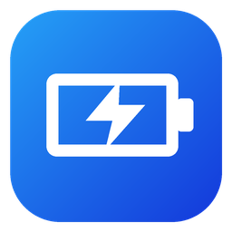

# Battery Monitor

A Windows 11 utility that displays the battery level of supported wireless peripherals directly on the taskbar.

**[Download the latest release](https://github.com/kross873/battery-monitor-releases/releases/latest)** · [All releases](https://github.com/kross873/battery-monitor-releases/releases)

## Features

- Monitor up to three selected devices in the taskbar widget.
- Standalone mode (no Windhawk required), or optional native integration through a local Windhawk mod.
- Customizable widget appearance and optional startup with Windows.
- Light, dark and system themes; English, Ukrainian and Russian interface languages.
- Built-in update center for official configured builds, using signed manifests and SHA-256 verification.

## Installation

Download the official x64 Windows installer from Releases. Choose the standalone or Windhawk mode in Setup. Windhawk is not bundled; for that mode, install Windhawk separately and follow [the supplied mod instructions](Windhawk/SETUP.txt). The official self-contained installer does not require the .NET SDK or Inno Setup on the user's PC.

## Compatibility

| Device or interface | Battery support |
| --- | --- |
| AJAZZ AJ179 APEX (USB receiver) | Confirmed on the developer's PC |
| Other AJAZZ models | Not yet confirmed individually |
| Bluetooth Battery Service / Windows battery properties | Experimental, device-dependent |
| Standard HID Battery Strength feature fields (including non-0–100 logical ranges) | Experimental, device-dependent |
| Windows device-node battery percentage | Experimental fallback, only if the driver exposes it |
| Windows controller battery API | Experimental, device-dependent |
| Logitech G435 (USB receiver) | Receiver detection; automatic percentage unavailable |
| Other proprietary USB receivers | Detection may work; battery protocol support is not guaranteed |

A detected device is not necessarily a supported battery source. Standalone widgets do not reserve taskbar space; native integration depends on Windows and Windhawk versions.

## Build from source

Requires Windows x64, the [.NET 8 SDK](https://dotnet.microsoft.com/download/dotnet/8.0), and [Inno Setup](https://jrsoftware.org/isdl.php) 6.3+ or 7 for installer creation.

1. Clone or download this repository and open its root folder.
2. Run `build-windows.cmd` to build the portable application in `publish/`, or `build-setup.cmd` to build the installer in `release/`.
3. Run `test-updates.cmd` to exercise the update protocol and battery-value normalization tests.

The checked-in `update-config.json` is intentionally unconfigured. A local build works without automatic updates. Official release builds use the publisher's own configuration and signing key. See [publisher notes](docs/DEVELOPMENT-RU.md) for the existing release workflow. Do not generate a replacement key for an already published update channel.

## Reporting issues

Include the application version, Windows version, peripheral model, connection type (USB receiver or Bluetooth), and expected and observed behavior. Remove personal details, local account paths, device serial numbers and secrets from any diagnostic output before sharing.

## Security

Never commit private signing keys, credentials or personal diagnostics. Signed update metadata is separate from Windows Authenticode signing. Do not disable antivirus or Windows security protections to install or test a build.

## License and acknowledgements

Battery Monitor's original source code is licensed under the [GNU General Public License v3.0 only](LICENSE). Third-party components retain their own terms. See [third-party acknowledgements and licenses](docs/THIRD-PARTY.md).

The matching source and applicable notices must accompany official binary releases. The release repository and this source repository are maintained separately.
